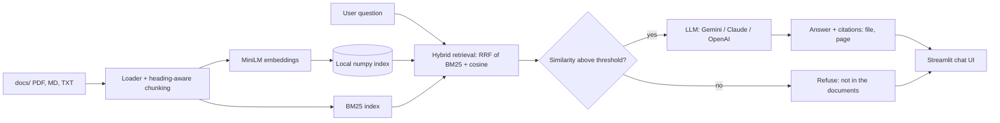

# RAG Docs Assistant

An AI assistant that answers questions **from your own company documents** (PDF, Markdown, TXT), cites the source file and page, and **refuses to answer when the documents don't contain the answer**.

## Problem

Teams lose hours searching handbooks, policies and FAQs, and plain chatbots invent answers. This project shows a small, auditable retrieval-augmented generation (RAG) pipeline that only answers from your files and shows its evidence.

## Architecture



## Features

- Ingests PDF, Markdown and TXT; heading-aware chunking with overlap
- Hybrid retrieval: BM25 + `all-MiniLM-L6-v2` embeddings fused with reciprocal rank fusion
- Citations per answer (file + page) with expandable source text
- Refusal guard: a similarity threshold plus a strict prompt, so it says "not in the documents" instead of guessing
- Pluggable LLM through env vars: Gemini (default `gemini-3-flash-preview`), Anthropic or OpenAI
- Upload box in the UI to add documents on the fly
- Fully local index and embeddings; only the final prompt goes to the LLM
- Eval script with retrieval hit rate and LLM-judged answer correctness

Screenshot: _add `docs/screenshot.png` of the Streamlit UI here after your first run._

## Run it

```bash
uv venv --python 3.12 .venv && uv pip install --python .venv/bin/python -r requirements.txt
cp .env.example .env   # add ONE of GEMINI_API_KEY / ANTHROPIC_API_KEY / OPENAI_API_KEY
.venv/bin/python src/ingest.py
.venv/bin/streamlit run src/app.py
```

Docker: `docker build -t rag-docs . && docker run -p 8501:8501 --env-file .env rag-docs`

Note: `requirements.txt` is pinned from an Intel macOS machine (torch 2.2.2, numpy<2). On Apple Silicon/Linux you can relax those pins.

## Evaluation

`python eval.py` runs 8 Q&A pairs over the 3 sample documents (7 answerable questions, 1 out-of-scope question that must be refused). Answers are graded by an LLM judge against a key fact.

| Metric | Result |
|---|---|
| Retrieval hit rate (right source file in top 4) | **7/7 (100%)** |
| Answer correctness (incl. correct refusal) | **8/8 (100%)** |

Run with `gemini-3-flash-preview`. The sample set is small and easy by design; treat it as a regression test, not a benchmark.

## Sample documents

`docs/` holds three **fictional** documents (Northwind Analytics handbook, Lumen Dashboard FAQ and refund policy). Replace them with your own files and re-run ingest.

## Author

Ned Akilkhanov, AI Automation & Data Engineer

## License

MIT
